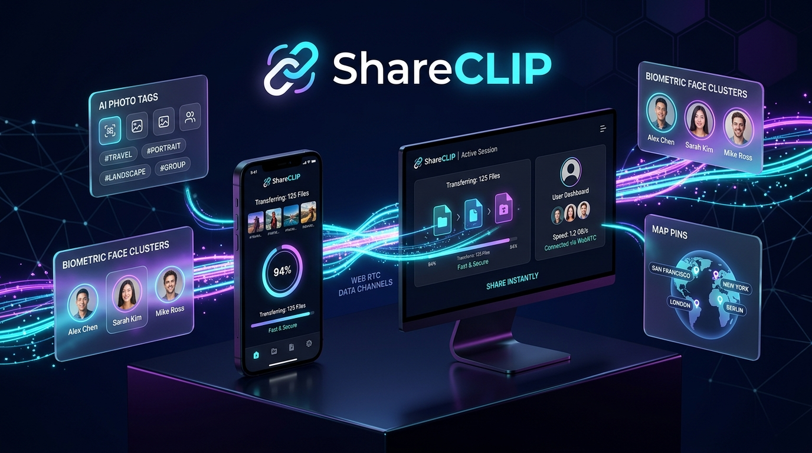
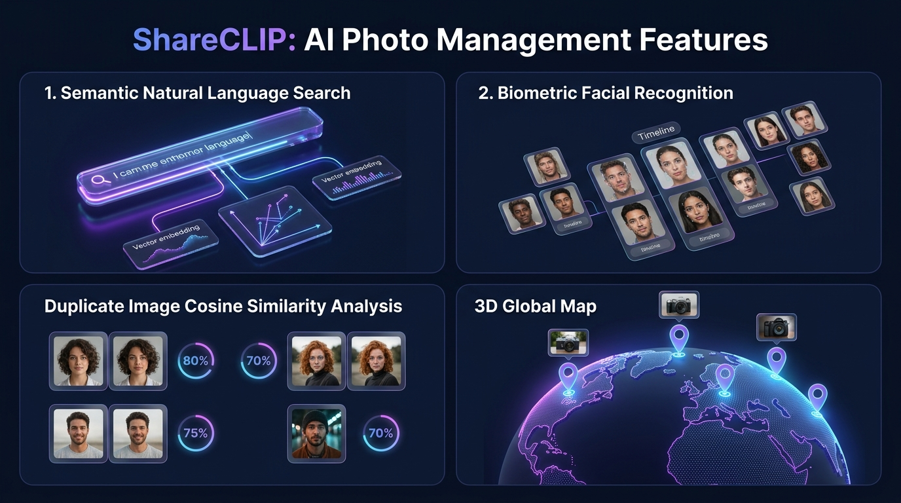
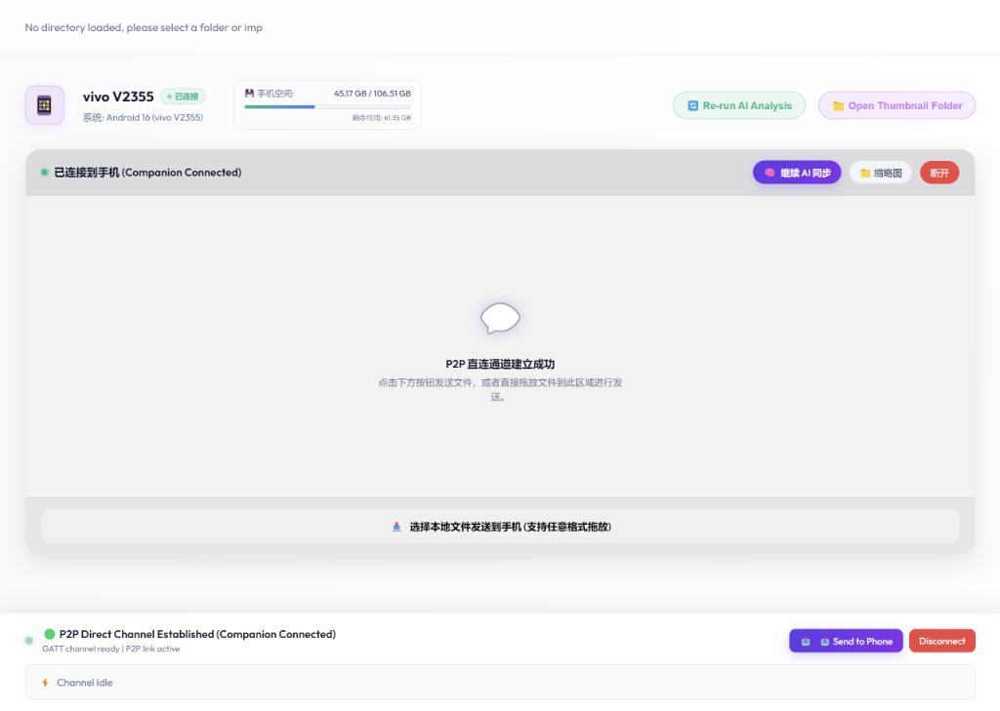
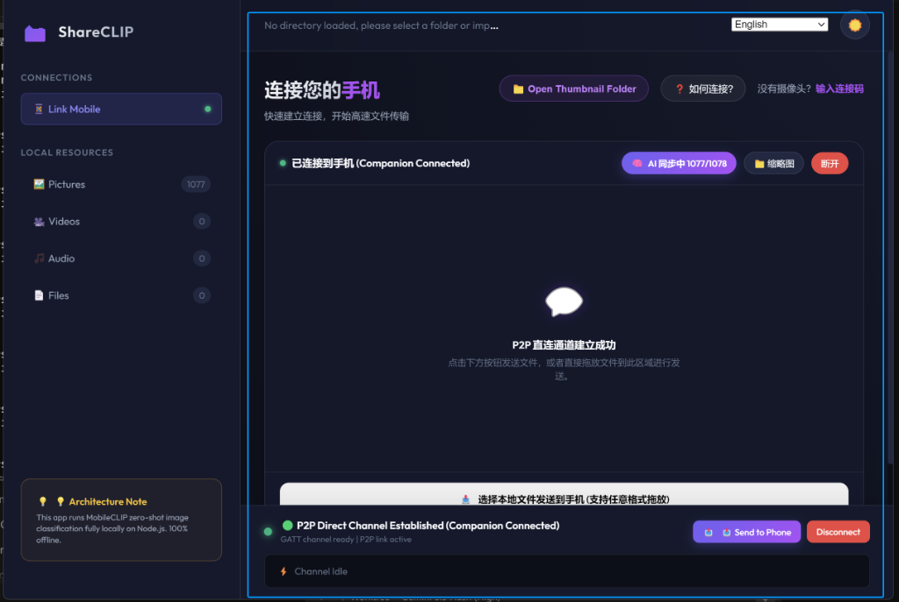
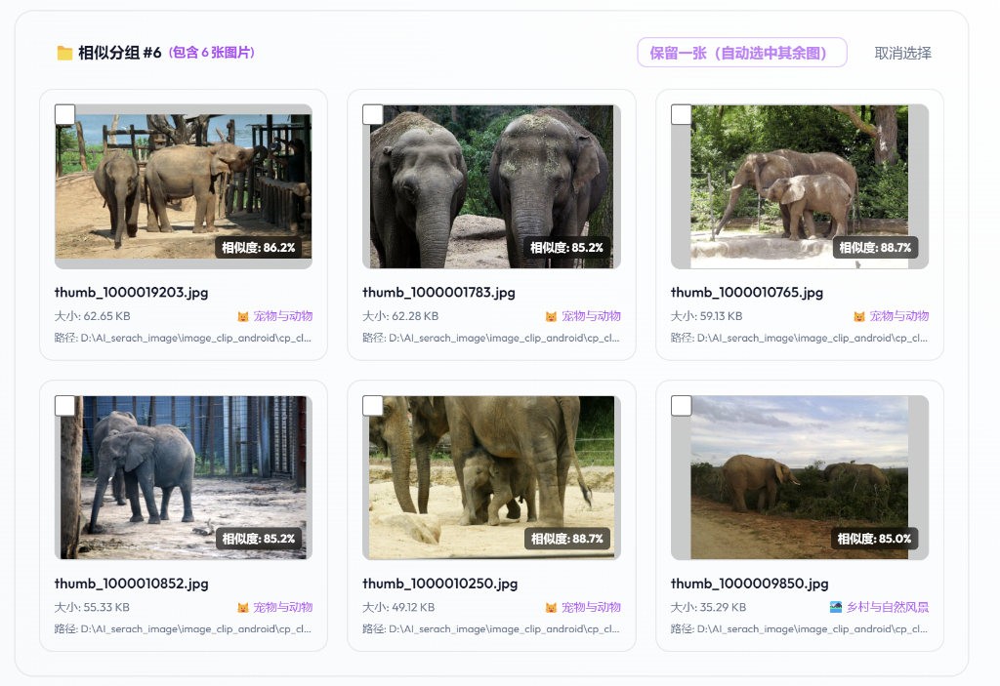
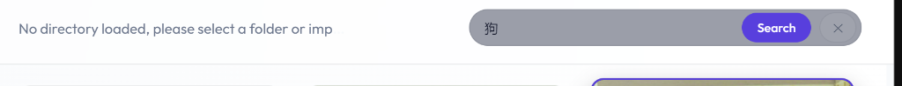

<div align="center">

  <p align="center">
    <a href="README.md"><b>English</b></a> &nbsp;|&nbsp; 
    <a href="README.zh-CN.md"><b>简体中文</b></a> &nbsp;|&nbsp; 
    <a href="README.zh-TW.md"><b>繁體中文</b></a> &nbsp;|&nbsp; 
    <a href="README.ja.md"><b>日本語</b></a>
  </p>

  <details>
    <summary style="cursor: pointer;"><b>🌐 20 Global Languages / 更多语言切换 (Click to expand / 点击展开 ▾)</b></summary>
    <br/>
    <table align="center">
      <tr>
        <td align="center"><a href="README.md">🇺🇸 English</a></td>
        <td align="center"><a href="README.zh-CN.md">🇨🇳 简体中文</a></td>
        <td align="center"><a href="README.zh-TW.md">🇭🇰 繁體中文</a></td>
        <td align="center"><a href="README.ja.md">🇯🇵 日本語</a></td>
        <td align="center"><b>🇰🇷 한국어</b></td>
      </tr>
      <tr>
        <td align="center"><a href="README.es.md">🇪🇸 Español</a></td>
        <td align="center"><a href="README.fr.md">🇫🇷 Français</a></td>
        <td align="center"><a href="README.de.md">🇩🇪 Deutsch</a></td>
        <td align="center"><a href="README.it.md">🇮🇹 Italiano</a></td>
        <td align="center"><a href="README.ru.md">🇷🇺 Русский</a></td>
      </tr>
      <tr>
        <td align="center"><a href="README.pt.md">🇵🇹 Português</a></td>
        <td align="center"><a href="README.vi.md">🇻🇳 Tiếng Việt</a></td>
        <td align="center"><a href="README.th.md">🇹🇭 ไทย</a></td>
        <td align="center"><a href="README.id.md">🇮🇩 Bahasa Indonesia</a></td>
        <td align="center"><a href="README.ar.md">🇸🇦 العربية</a></td>
      </tr>
      <tr>
        <td align="center"><a href="README.hi.md">🇮🇳 हिन्दी</a></td>
        <td align="center"><a href="README.tr.md">🇹🇷 Türkçe</a></td>
        <td align="center"><a href="README.pl.md">🇵🇱 Polski</a></td>
        <td align="center"><a href="README.nl.md">🇳🇱 Nederlands</a></td>
        <td align="center"><a href="README.sv.md">🇸🇪 Svenska</a></td>
      </tr>
    </table>
    <br/>
  </details>

  

  <br/><br/>

  # 📸 ShareCLIP
  ### 비공개 초고속 P2P 사진 동기화 & 100% 온디바이스 로컬 AI 갤러리
  *(Formerly AIShare-Grabber)*

  <p align="center">
    <b>초고속 로컬 Wi-Fi를 통해 스마트폰과 PC/Mac 간에 사진을 케이블 없이 직접 전송하세요.<br/>100% 온디바이스 오프라인 AI로 일상 언어로 사진을 검색하고 스마트하게 정리합니다.</b>
  </p>

  <p align="center">
    <b>🚫 클라우드 업로드 없음 &nbsp;•&nbsp; 🔌 USB 케이블 불필요 &nbsp;•&nbsp; 💳 구독료 없음 &nbsp;•&nbsp; 🔒 100% 안전한 오프라인</b>
  </p>

  <!-- Badges Grid -->
  <p align="center">
    <a href="https://novamindlab.github.io/AIShare-Grabber/">
      
    </a>
    &nbsp;
    <a href="ms-windows-store://search/?query=ShareCLIP">
      
    </a>
  </p>

  <p align="center">
    <a href="https://github.com/NovaMindLab/AIShare-Grabber/releases/latest">
      
    </a>
    &nbsp;
    <a href="https://novamindlab.github.io/AIShare-Grabber/">
      
    </a>
    &nbsp;
    <a href="https://github.com/NovaMindLab/AIShare-Grabber/releases/latest">
      
    </a>
    &nbsp;
    <a href="https://novamindlab.github.io/AIShare-Grabber/webshare/">
      
    </a>
  </p>

  <p align="center">
    <a href="https://github.com/NovaMindLab/AIShare-Grabber/releases"></a>
    <a href="https://github.com/NovaMindLab/AIShare-Grabber/stargazers"></a>
    
    
    
    <a href="https://github.com/NovaMindLab/AIShare-Grabber/blob/main/LICENSE"></a>
  </p>

</div>

---

## ⚡ 5초 만에 알아보는 작동 원리

```
┌─────────────────────────┐          High-Speed Wi-Fi P2P         ┌─────────────────────────┐
│     Mobile Phone 📱     │ ────────────────────────────────────> │      PC / Mac 🖥️        │
│ (Scan QR / Auto-Wakeup) │        (Zero Cloud • 80+ MB/s)        │     (Local Storage)     │
└─────────────────────────┘                                       └────────────┬────────────┘
                                                                               │
                                                                               ▼
                                                                  ┌─────────────────────────┐
                                                                  │    Local AI Engine 🧠   │
                                                                  │ (100% On-Device Models) │
                                                                  └────────────┬────────────┘
                                                                               │
                                                                               ▼
                                                                  🔍 "golden retriever in snow"
                                                                  🔍 "sunset beach with cocktails"
                                                                  🔍 "restaurant receipt last week"
```

1. **즉각적인 무선 페어링: 모바일 카메라나 앱으로 PC 화면의 QR 코드를 스캔하면 즉시 연결됩니다.**
2. **초고속 기가비트 P2P 전송: 로컬 Wi-Fi를 통해 80+ MB/s 속도로 직접 전송되며 모바일 데이터를 전혀 쓰지 않습니다.**
3. **100% 오프라인 AI 색인: PC 로컬 하드웨어에서 MobileCLIP 신경망 임베딩 및 얼굴 인식을 수행합니다.**
4. **자연어 사진 검색: '풀밭을 달리는 강아지', '노을 지는 해변' 등 일상 언어로 즉시 사진을 찾습니다.**

---

## 🎬 See It In Action

### Wireless High-Throughput P2P Streaming Pipeline
<div align="center">
  
</div>

<br/>

> 🎥 **Interactive Web Demo**: Try our [Official Website](https://novamindlab.github.io/AIShare-Grabber/) or test the [Zero-Install WebShare](https://novamindlab.github.io/AIShare-Grabber/webshare/).

---

## ✨ 핵심 기능 및 특징

<div align="center">
  
</div>

<br/>

* **⚡ 초고속 무선 P2P 동기화 (80+ MB/s): 기가비트 로컬 네트워크를 통해 수천 장의 사진을 순식간에 백업.**
* **🔍 멀티모달 자연어 AI 사진 검색: 태그 작업 없이 일상 언어 검색으로 원하는 사진을 밀리초 만에 탐색.**
* **👥 온디바이스 안면 인식 및 인물 앨범: SCRFD + MobileFaceNet 기반으로 가족과 친구를 비공개로 자동 분류.**
* **🧹 중복/연사 사진 스마트 정리: SIMD WASM 벡터 클러스터링으로 중복 사진을 찾고 PC와 폰에서 동시 삭제.**
* **🗺️ EXIF GPS 발자국 지도 및 타임라인: 사진 속 위치 정보를 파싱하여 지도 위에 인터랙티브하게 표시.**
* **📱 스마트 모바일 딥링크 및 다운로드 연동: QR 코드 스캔 시 앱이 자동 실행되거나 설치 페이지로 연결.**
* **🎵 사이버 하이파이 라디오 & yt-dlp 다운로더: 고화질 미디어 다운로드 및 감성적인 Lo-Fi 배경음악 지원.**

---

## 📸 App Showcase

<table width="100%">
  <tr>
    <td width="50%" align="center">
      <b>📱 One-Tap Phone Connection & Storage Status</b><br/>
      
    </td>
    <td width="50%" align="center">
      <b>⚡ High-Speed Transfer & AI Synchronization</b><br/>
      
    </td>
  </tr>
  <tr>
    <td width="50%" align="center">
      <b>🧹 Smart Duplicate & Similar Image Clustering</b><br/>
      
    </td>
    <td width="50%" align="center">
      <b>🔍 Local Natural Language Query & Detection</b><br/>
      
    </td>
  </tr>
</table>

---

## ⚖️ 왜 ShareCLIP인가요? (경쟁 제품 비교)

| Capability / Feature | ✨ ShareCLIP | ☁️ Cloud Albums (Google / iCloud) | 🔌 USB Cable Transfer | 📡 AirDrop / Nearby Share |
|:---|:---:|:---:|:---:|:---:|
| **P2P Wireless Transfer** | ✅ **Yes (80+ MB/s LAN)** | ❌ No (Uploads to remote server) | ❌ Wired only | ✅ Local wireless |
| **Cross-Platform (Win/Mac/Android)** | ✅ **Yes (All platforms)** | ⚠️ Ecosystem-locked | ⚠️ Complex drivers | ❌ Apple or Android only |
| **Zero Cloud Upload** | ✅ **100% Private & Local** | ❌ Uploads to third parties | ✅ Local only | ✅ Local only |
| **Natural Language AI Search** | ✅ **On-Device (Offline)** | ⚠️ Cloud AI (Privacy concern) | ❌ None | ❌ None |
| **Biometric Face Recognition** | ✅ **On-Device (ArcFace)** | ⚠️ Cloud AI | ❌ None | ❌ None |
| **Duplicate Shot Cleanup** | ✅ **Synchronized 2-Way** | ⚠️ Partial / Complex | ❌ Manual browsing | ❌ None |
| **Subscription / Cloud Costs** | 🆓 **Free & Open Source** | 💳 $2~$10 / month | 🆓 Free | 🆓 Free |
| **Mobile Cellular Data Usage** | ⚡ **0 MB (LAN only)** | 📶 Heavy data consumption | ⚡ 0 MB | ⚡ 0 MB |

---

## 🚀 설치 및 빠른 시작 가이드

### 📦 Quick Install via Package Managers

#### Windows (WinGet / Scoop)
```powershell
# Install via official WinGet
winget install NovaMindLab.ShareCLIP

# Or install via Scoop
scoop bucket add novamindlab https://github.com/NovaMindLab/scoop-bucket
scoop install shareclip
```

#### macOS (Homebrew Cask)
```bash
# Direct install via Homebrew Cask
brew tap NovaMindLab/homebrew-tap
brew install --cask shareclip
```

---

### 🌐 Manual Downloads (Desktop & Mobile)

| Platform | Recommended Download | Alternative |
|:---|:---|:---|
| **Windows** (10/11 x64) | [🏪 Microsoft Store](ms-windows-store://search/?query=ShareCLIP) | [⬇️ Windows Setup (.exe)](https://github.com/NovaMindLab/AIShare-Grabber/releases/latest) |
| **macOS** (Apple Silicon M1~M4) | [⬇️ Apple Silicon DMG](https://novamindlab.github.io/AIShare-Grabber/) | [GitHub Releases](https://github.com/NovaMindLab/AIShare-Grabber/releases/latest) |
| **macOS** (Intel x64) | [⬇️ Intel DMG](https://novamindlab.github.io/AIShare-Grabber/) | [GitHub Releases](https://github.com/NovaMindLab/AIShare-Grabber/releases/latest) |
| **Android** (Phone / Tablet) | [⬇️ Universal APK](https://github.com/NovaMindLab/AIShare-Grabber/releases/latest) | [📱 Smart QR Install](https://novamindlab.github.io/AIShare-Grabber/share.html) |
| **Any Browser** | [⚡ Launch WebShare](https://novamindlab.github.io/AIShare-Grabber/webshare/) | Zero-install required |

---

## 🧠 기술 아키텍처 심층 분석

```mermaid
flowchart LR
    subgraph Mobile [Android Companion / WebShare]
        A[MediaStore / PhotoManager] -->|Concurrent Extraction| B[400x400 Thumbnail Stream]
        B -->|Chunked 16KB-32KB Binary Frames| C[WebRTC DataChannel]
    end

    subgraph Desktop [PC Host Electron]
        C -->|Rapid Disk Write| D[Local Isolated Storage]
        D -->|Task Queue Dispatch| E[ONNX Worker Pool]
        
        subgraph AI_Engine [On-Device AI Acceleration]
            E -->|MobileCLIP-S0 256x256| F[512-D Image Embedding]
            E -->|SCRFD + MobileFaceNet| G[Face Biometric 512-D]
            F & G -->|Lock-Free Single Writer| H[(SharedArrayBuffer 40MB-200MB)]
        end
        
        H -->|Zero-Copy SIMD Dot Product| I[Sub-Millisecond Cosine Search]
        I --> J[Vue 3 60fps Virtual Timeline]
    end
```



---

## 💻 개발자 가이드 및 소스 빌드

```
AIShare-Grabber/
├── 📱 android/      # Flutter Android Companion App (BLE GATT + WebRTC DataChannel)
├── 🖥️ cp_clip/      # Desktop Host App (Electron 30, Vue 3, ONNX Runtime, SQLite, Sharp)
├── 🌐 web/          # Official Portal & Interactive Download Landing Page
├── ⚡ webshare/     # Pure Web Client (WebGPU + WebRTC P2P + IndexedDB)
├── 📦 manifests/    # Package manager manifests (WinGet, Scoop, Homebrew)
└── 📖 wiki/         # Comprehensive Architecture & Protocol Documentation
```

---

## 📖 기술 문서 및 위키

- [📐 AI Architecture & Zero-Copy SAB Deep Dive](wiki/ai_architecture.md)
- [📡 WebRTC Channel Protocol & 16-Byte Headers](wiki/android/WebRTC_Protocol.md)
- [👤 Face Recognition & Same-Photo Exclusion Clustering](wiki/features/face_recognition.md)
- [📶 BLE GATT Signaling & Fallback Architecture](wiki/pc/ble_gatt_compatibility_and_fallback.md)
- [🚀 Universal Release & Promotion Blueprint](wiki/deployment/universal_release_and_promotion_blueprint.md)

---

## 📄 라이선스 및 개인정보 보호 보증

- **100% Privacy Guarantee**: ShareCLIP is architected strictly around **Zero-Cloud & Zero-Telemetry** principles.
- **License**: Released under the open-source [MIT License](https://github.com/NovaMindLab/AIShare-Grabber/blob/main/LICENSE).

<div align="center">
  <sub>Developed with ❤️ by the <b>NovaMindLab</b> team.</sub>
</div>
