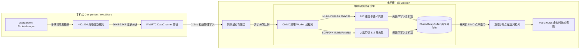

<div align="center">

  <p align="center">
    <a href="README.md"><b>English</b></a> &nbsp;|&nbsp; 
    <b>简体中文</b> &nbsp;|&nbsp; 
    <a href="README.zh-TW.md"><b>繁體中文</b></a> &nbsp;|&nbsp; 
    <a href="README.ja.md"><b>日本語</b></a>
  </p>

  <details>
    <summary style="cursor: pointer;"><b>🌐 20 种全球语言版本切换 / More Languages (点击展开 ▾)</b></summary>
    <br/>
    <table align="center">
      <tr>
        <td align="center"><a href="README.md">🇺🇸 English</a></td>
        <td align="center"><b>🇨🇳 简体中文</b></td>
        <td align="center"><a href="README.zh-TW.md">🇭🇰 繁體中文</a></td>
        <td align="center"><a href="README.ja.md">🇯🇵 日本語</a></td>
        <td align="center"><a href="README.ko.md">🇰🇷 한국어</a></td>
      </tr>
      <tr>
        <td align="center"><a href="README.es.md">🇪🇸 Español</a></td>
        <td align="center"><a href="README.fr.md">🇫🇷 Français</a></td>
        <td align="center"><a href="README.de.md">🇩🇪 Deutsch</a></td>
        <td align="center"><a href="README.it.md">🇮🇹 Italiano</a></td>
        <td align="center"><a href="README.ru.md">🇷🇺 Русский</a></td>
      </tr>
      <tr>
        <td align="center"><a href="README.pt.md">🇵🇹 Português</a></td>
        <td align="center"><a href="README.vi.md">🇻🇳 Tiếng Việt</a></td>
        <td align="center"><a href="README.th.md">🇹🇭 ไทย</a></td>
        <td align="center"><a href="README.id.md">🇮🇩 Bahasa Indonesia</a></td>
        <td align="center"><a href="README.ar.md">🇸🇦 العربية</a></td>
      </tr>
      <tr>
        <td align="center"><a href="README.hi.md">🇮🇳 हिन्दी</a></td>
        <td align="center"><a href="README.tr.md">🇹🇷 Türkçe</a></td>
        <td align="center"><a href="README.pl.md">🇵🇱 Polski</a></td>
        <td align="center"><a href="README.nl.md">🇳🇱 Nederlands</a></td>
        <td align="center"><a href="README.sv.md">🇸🇪 Svenska</a></td>
      </tr>
    </table>
    <br/>
  </details>

  

  <br/><br/>

  # 📸 ShareCLIP
  ### 私有 P2P 高速无线照片同步 & 100% 本地离线 AI 相册
  *(原名 AIShare-Grabber)*

  <p align="center">
    <b>基于千兆局域网 Wi-Fi，在手机、Windows PC 与 Mac 之间极速传输照片。</b><br/>
    <b>利用 100% 端侧离线 AI 模型，大白话以文搜图、人脸智能聚类与私密相册整理。</b>
  </p>

  <p align="center">
    <b>🚫 绝不上云 &nbsp;•&nbsp; 🔌 告别数据线 &nbsp;•&nbsp; 💳 无订阅费用 &nbsp;•&nbsp; 🔒 100% 离线隐私安全</b>
  </p>

  <!-- 徽章区域 -->
  <p align="center">
    <a href="https://novamindlab.github.io/AIShare-Grabber/">
      
    </a>
    &nbsp;
    <a href="ms-windows-store://search/?query=ShareCLIP">
      
    </a>
  </p>

  <p align="center">
    <a href="https://github.com/NovaMindLab/AIShare-Grabber/releases/latest">
      
    </a>
    &nbsp;
    <a href="https://novamindlab.github.io/AIShare-Grabber/">
      
    </a>
    &nbsp;
    <a href="https://github.com/NovaMindLab/AIShare-Grabber/releases/latest">
      
    </a>
    &nbsp;
    <a href="https://novamindlab.github.io/AIShare-Grabber/webshare/">
      
    </a>
  </p>

  <p align="center">
    <a href="https://github.com/NovaMindLab/AIShare-Grabber/releases"></a>
    <a href="https://github.com/NovaMindLab/AIShare-Grabber/stargazers"></a>
    
    
    
    <a href="https://github.com/NovaMindLab/AIShare-Grabber/blob/main/LICENSE"></a>
  </p>

  <!-- 快速导航锚点 -->
  <p align="center">
    <a href="#-5-秒快速了解运作原理"><b>⚡ 运作原理</b></a> •
    <a href="#-核心特性深度解析"><b>✨ 核心特性</b></a> •
    <a href="#-应用实机截屏"><b>📸 实机展示</b></a> •
    <a href="#-对比与优势为什么选择-shareclip"><b>⚖️ 竞品对比</b></a> •
    <a href="#-下载安装与快速开始"><b>🚀 快速开始</b></a> •
    <a href="#-底层技术架构深度剖析"><b>🧠 技术架构</b></a> •
    <a href="#-源码编译与开发者指南"><b>💻 开发者指南</b></a>
  </p>

</div>

---

## ⚡ 5 秒快速了解运作原理

```
┌─────────────────────────┐          局域网 Wi-Fi P2P 高速直传          ┌─────────────────────────┐
│        手机端 📱        │ ───────────────────────────────────────> │      电脑端 PC/Mac 🖥️   │
│  (扫码秒连 / 智能唤起)  │          (零云端中转 • 80+ MB/s)         │       (完全本地存储)     │
└─────────────────────────┘                                          └────────────┬────────────┘
                                                                                  │
                                                                                  ▼
                                                                     ┌─────────────────────────┐
                                                                     │     端侧离线 AI 引擎 🧠 │
                                                                     │   (100% 本地多模态推理) │
                                                                     └────────────┬────────────┘
                                                                                  │
                                                                                  ▼
                                                                     🔍 "草地上奔跑的金毛寻回犬"
                                                                     🔍 "傍晚海边的日落与鸡尾酒"
                                                                     🔍 "上个月聚餐的餐饮增值税发票"
```

1. **秒级无线配对**：打开手机客户端扫描电脑端二维码即可快速握手配对；支持使用系统相机或浏览器直接扫码，已安装则自动唤起应用，未安装则自动进入轻量落地页。
2. **千兆 P2P 无线传输**：照片直接通过本地 Wi-Fi / WebRTC DataChannel 点对点直传，实测速度高达 **80+ MB/s**。无需找数据线，不耗费手机流量。
3. **100% 离线端侧 AI 建库**：电脑端调用本地硬件（DirectML / CPU）自动提取 Apple MobileCLIP 512 维特征向量与人脸特征，完全不依赖外部接口。
4. **自然语言大白话搜图**：输入任意日常语言（无需预先打标签），毫秒级精准定位任何历史瞬间。

---

## 🎬 动态效果展示

### 全离线高速 P2P 数据流转流水线
所有照片传输绝不经过第三方公网中转服务器。手机与桌面端基于 BLE 低功耗蓝牙广播或局域网 UDP 发现彼此，就地打通高带宽、加密的 **WebRTC P2P DataChannel**：

<div align="center">
  
</div>

<br/>

> 🎥 **互动体验与高清视频**：访问 [ShareCLIP 官方网站](https://novamindlab.github.io/AIShare-Grabber/) 观看 1080P 实际演示，或直接尝试 [免安装 WebShare 在线互传](https://novamindlab.github.io/AIShare-Grabber/webshare/)。

---

## ✨ 核心特性深度解析

<div align="center">
  
</div>

<br/>

### 1. ⚡ 千兆级无线 P2P 秒传
* **80+ MB/s 传输吞吐**：数千张单反原图或手机照片在局域网内瞬间完成同步备份。
* **摆脱数据线束缚**：再也不用费劲翻找 Type-C 数据线，也没有驱动识别失败或 MTP 模式卡死的困扰。
* **零移动流量消耗**：完全依靠局域网设备间点对点通信，甚至在无外网的路由器或手机热点下也能畅快互传。

### 2. 🔍 多模态自然语言 AI 搜图
* **用日常大白话搜图**：搜索 *“在草地奔跑的小狗”*、*“海边日落晚霞”*、*“带印章的发票报销单”*，无需人工手动打标。
* **MobileCLIP 深度图文特征表征**：将文本与图像投射至对齐的 512 维向量空间，实现亚毫秒级向量检索。
* **DirectML 硬件全适配**：自动智能适配独立显卡（NVIDIA / AMD）、集成显卡（Intel Iris/Xe）与多核 CPU。

### 3. 👥 本地生物特征人脸识别与人物相册
* **端侧人脸聚类**：采用 **SCRFD 500M** 超轻量人脸检测与 **MobileFaceNet** ArcFace 512 维人脸特征提取模型。
* **生物特征绝不上云**：所有的人脸特征提取、聚类归档均在本地内存和显卡完成，彻底消除隐私泄露风险。

### 4. 🧹 相似图与连拍智能筛选去重
* **SIMD WASM 向量聚类**：毫秒级全量点积比对，自动将相似连拍、重复构图的照片分组成簇。
* **双端联动同步清理**：在电脑大屏幕上一键标记废片，确认后同步通知手机端彻底删除，为双端同时释放宝贵空间。

### 5. 🗺️ EXIF 旅行足迹地图与时光轴
* **全景交互式足迹地图**：自动解析照片的 EXIF GPS 经纬度信息，按地理分布聚合标注为时光足迹。
* **流畅 60 FPS 虚拟长列表**：针对 50,000+ 超大照片相册深度优化，滑动丝滑无卡顿。

### 6. 📱 手机智能唤起与网页落地页分流
* **智能二维码路由**：手机相机或任意浏览器扫码后，系统检测到已安装 ShareCLIP 则直接通过 `shareclip://open` Deep Link 自动进入连接状态；若未安装，则自动引导至免打扰的高速下载落地页。
* **免安装 WebShare 互传**：好友电脑没有安装客户端时，只需通过 Chrome / Edge 打开 WebShare 网页，即可利用 WebRTC 与手机或电脑进行点对点极速文件互传。

### 7. 🎵 赛博朋克 Hi-Fi 氛围电台与音视频下载
* **内置媒体下载内核**：深度集成 `yt-dlp` 高性能下载内核，支持一键保存高清多媒体资源至本地素材库。
* **沉浸式 Lo-Fi 氛围工作站**：在浏览和整理相册的同时，随时享受内置的高保真白噪音与 Cyber 氛围电台。

---

## 📸 应用实机截屏

<table width="100%">
  <tr>
    <td width="50%" align="center">
      <b>📱 一键扫码配对与双端存储概览</b><br/>
      
    </td>
    <td width="50%" align="center">
      <b>⚡ 高速后台同步与 AI 索引进度</b><br/>
      
    </td>
  </tr>
  <tr>
    <td width="50%" align="center">
      <b>🧹 相似连拍聚类与一键空间瘦身</b><br/>
      
    </td>
    <td width="50%" align="center">
      <b>🔍 纯本地自然语言语义搜索实测</b><br/>
      
    </td>
  </tr>
</table>

---

## ⚖️ 对比与优势（为什么选择 ShareCLIP？）

| 功能维度 | ✨ ShareCLIP | ☁️ 商业云相册 (Google / iCloud) | 🔌 传统 USB 数据线 | 📡 AirDrop / 隔空投送 |
|:---|:---:|:---:|:---:|:---:|
| **无线局域网高速传输** | ✅ **支持 (80+ MB/s)** | ❌ 依赖公网上传下载 | ❌ 仅限有线连接 | ✅ 仅限局域网无线 |
| **跨平台互通 (Win/Mac/安卓)** | ✅ **全平台覆盖** | ⚠️ 生态封闭互通难 | ⚠️ 需驱动与多次确认 | ❌ 仅苹果生态独占 |
| **数据是否上云** | ✅ **100% 本地私有** | ❌ 上传至第三方云端 | ✅ 本地存储 | ✅ 本地存储 |
| **自然语言 AI 搜图** | ✅ **纯本地离线推理** | ⚠️ 云端分析（隐私顾虑） | ❌ 无搜索功能 | ❌ 无搜索功能 |
| **人脸识别与相册整理** | ✅ **本地 ArcFace 模型** | ⚠️ 云端人脸比对 | ❌ 无 | ❌ 无 |
| **双端联动废片清理** | ✅ **电脑端标记/手机端同步删** | ⚠️ 逻辑复杂易误删 | ❌ 需手动浏览文件夹 | ❌ 无联动清理 |
| **长期存储成本** | 🆓 **永久免费 & 开源** | 💳 每月订阅费 (15~68元/月) | 🆓 免费 | 🆓 免费 |
| **手机移动流量消耗** | ⚡ **0 MB (纯内网流量)** | 📶 耗费大量蜂窝流量 | ⚡ 0 MB | ⚡ 0 MB |

---

## 🚀 下载安装与快速开始

### 📦 途径一：包管理器一键安装（推荐开发者）

#### Windows (WinGet / Scoop)
```powershell
# 微软官方 WinGet 一键安装
winget install NovaMindLab.ShareCLIP

# 或通过 Scoop 社区包管理器安装
scoop bucket add novamindlab https://github.com/NovaMindLab/scoop-bucket
scoop install shareclip
```

#### macOS (Homebrew Cask)
```bash
# 苹果 macOS 终端一键安装
brew tap NovaMindLab/homebrew-tap
brew install --cask shareclip
```

---

### 🌐 途径二：各平台直接下载安装包

| 操作系统 / 设备 | 推荐安装通道 | 备用下载通道 |
|:---|:---|:---|
| **Windows** (10/11 64位) | [🏪 微软应用商店 (Microsoft Store)](ms-windows-store://search/?query=ShareCLIP) | [⬇️ Windows 安装包 (.exe)](https://github.com/NovaMindLab/AIShare-Grabber/releases/latest) |
| **macOS** (Apple Silicon M1~M4) | [⬇️ 官网智能适配 DMG](https://novamindlab.github.io/AIShare-Grabber/) | [GitHub Releases 下载](https://github.com/NovaMindLab/AIShare-Grabber/releases/latest) |
| **macOS** (Intel x64 架构) | [⬇️ 官网智能适配 DMG](https://novamindlab.github.io/AIShare-Grabber/) | [GitHub Releases 下载](https://github.com/NovaMindLab/AIShare-Grabber/releases/latest) |
| **Android 手机 / 平板** | [⬇️ 官网高速直链 (Universal APK)](https://github.com/NovaMindLab/AIShare-Grabber/releases/latest) | [📱 扫码直接下载页面](https://novamindlab.github.io/AIShare-Grabber/share.html) |
| **任意设备现代浏览器** | [⚡ 立即打开 WebShare 在线互传](https://novamindlab.github.io/AIShare-Grabber/webshare/) | 无需安装任何软件 |

---

## 🧠 底层技术架构深度剖析

针对系统架构师、端侧 AI 开发者与开源贡献者的底层运行流程：



### 核心架构亮点
* **无锁 SharedArrayBuffer 物理内存共享**：彻底消除 Node.js IPC 跨进程序列化消耗，512 维神经向量直接投射至共享内存块。在 5,000 张照片中完成全量余弦聚类仅需 **~120ms**。
* **16 字节极简二进制帧协议**：定长头部设计（`fileId`, `chunkIndex`, `totalChunks`, `payloadLength`），结合自适应背压流量控制，确保千兆吞吐下网卡与磁盘平稳不丢包。
* **DirectML ➔ CPU 智能降级回退**：完美兼容包括 NVIDIA、AMD 独显、Intel 锐炬核显在内的绝大多数 Windows/Mac PC 硬件。

---

## 💻 源码编译与开发者指南

### 工程代码仓库结构
```
AIShare-Grabber/
├── 📱 android/      # Flutter Android 手机客户端 (BLE GATT + WebRTC DataChannel)
├── 🖥️ cp_clip/      # 桌面端宿主 (Electron 30, Vue 3, ONNX Runtime, SQLite, Sharp)
│   ├── src/workers/ # 多线程 Worker 池 (向量搜索、SIMD WASM 聚类、ONNX 推理)
│   └── models/      # 量化压缩版 MobileCLIP-S0 与 Buffalo_SC 模型
├── 🌐 web/          # 官方门户网站与手机端扫码智能分流落地页
├── ⚡ webshare/     # 纯前端点对点 Web 互传终端 (WebGPU + WebRTC + IndexedDB)
├── 📦 manifests/    # 包管理器全平台清单 (WinGet, Scoop, Homebrew)
└── 📖 wiki/         # 完整的系统设计规范与协议开发文档
```

### 1. Android 移动端编译
```bash
# 环境要求：Flutter SDK >= 3.11.1 & Android SDK
cd android
flutter pub get
flutter run --release
```

### 2. 桌面端 (PC & Mac) 编译
```bash
# 环境要求：Node.js >= 20, Python >= 3.10
cd cp_clip
npm install

# 启动本地开发热重载模式
npm run dev

# 构建正式分发安装包
npm run dist
```

### 3. 官方门户网站调试
```bash
cd web
npm install
npm run dev
```

---

## 📖 技术文档与开发者 Wiki

深入查阅我们在 [Project Wiki](wiki/README.md) 中沉淀的完整架构与技术设计：
- [📐 离线 AI 架构与零拷贝 SharedArrayBuffer 深度剖析](wiki/ai_architecture.md)
- [📡 WebRTC P2P 二进制数据通道与 16 字节协议头规范](wiki/android/WebRTC_Protocol.md)
- [👤 本地人脸识别系统与同照互斥聚类算法](wiki/features/face_recognition.md)
- [📶 BLE GATT 蓝牙信令协商与兼容降级架构](wiki/pc/ble_gatt_compatibility_and_fallback.md)
- [🚀 独立通用发布与全渠道推广Wiki蓝皮书](wiki/deployment/universal_release_and_promotion_blueprint.md)

---

## 📄 开源许可与隐私承诺

- **100% 隐私承诺**：ShareCLIP 严格秉承 **Zero-Cloud（零云端）与 Zero-Telemetry（零回传）** 的设计原则。您的照片原图、地理位置 EXIF 数据以及生物人脸特征 **绝不会** 离开您的本地设备。
- **开源协议**：本项目基于宽松的 [MIT License](https://github.com/NovaMindLab/AIShare-Grabber/blob/main/LICENSE) 协议发布，自由使用。

<div align="center">
  <sub>Developed with ❤️ by the <b>NovaMindLab</b> team.</sub>
</div>
