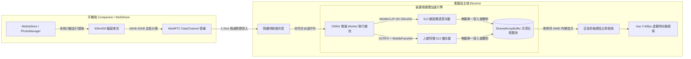

<div align="center">

  <p align="center">
    <a href="README.md"><b>English</b></a> &nbsp;|&nbsp; 
    <a href="README.zh-CN.md"><b>简体中文</b></a> &nbsp;|&nbsp; 
    <b>繁體中文</b>
  </p>

  

  <br/><br/>

  # 📸 ShareCLIP
  ### 私有 P2P 高速無線相片同步 & 100% 本地離線 AI 相簿
  *(原名 AIShare-Grabber)*

  <p align="center">
    <b>基於 Gigabit 區域網路 Wi-Fi，在手機、Windows PC 與 Mac 之間極速傳輸相片。</b><br/>
    <b>利用 100% 裝置端離線 AI 模型，以自然語言搜尋相片、人臉智慧分群與隱私相簿整理。</b>
  </p>

  <p align="center">
    <b>🚫 絕不上雲 &nbsp;•&nbsp; 🔌 告別傳輸線 &nbsp;•&nbsp; 💳 無訂閱費用 &nbsp;•&nbsp; 🔒 100% 離線隱私安全</b>
  </p>

  <!-- 徽章區域 -->
  <p align="center">
    <a href="https://novamindlab.github.io/AIShare-Grabber/">
      
    </a>
    &nbsp;
    <a href="ms-windows-store://search/?query=ShareCLIP">
      
    </a>
  </p>

  <p align="center">
    <a href="https://github.com/NovaMindLab/AIShare-Grabber/releases/latest">
      
    </a>
    &nbsp;
    <a href="https://novamindlab.github.io/AIShare-Grabber/">
      
    </a>
    &nbsp;
    <a href="https://github.com/NovaMindLab/AIShare-Grabber/releases/latest">
      
    </a>
    &nbsp;
    <a href="https://novamindlab.github.io/AIShare-Grabber/webshare/">
      
    </a>
  </p>

  <p align="center">
    <a href="https://github.com/NovaMindLab/AIShare-Grabber/releases"></a>
    <a href="https://github.com/NovaMindLab/AIShare-Grabber/stargazers"></a>
    
    
    
    <a href="https://github.com/NovaMindLab/AIShare-Grabber/blob/main/LICENSE"></a>
  </p>

  <!-- 快速導覽錨點 -->
  <p align="center">
    <a href="#-5-秒快速了解運作原理"><b>⚡ 運作原理</b></a> •
    <a href="#-核心特性深度解析"><b>✨ 核心特性</b></a> •
    <a href="#-應用實機截圖"><b>📸 實機展示</b></a> •
    <a href="#-評比與優勢為什麼選擇-shareclip"><b>⚖️ 競品對比</b></a> •
    <a href="#-下載安裝與快速開始"><b>🚀 快速開始</b></a> •
    <a href="#-底層技術架構深度剖析"><b>🧠 技術架構</b></a> •
    <a href="#-原始碼編譯與開發者指南"><b>💻 開發者指南</b></a>
  </p>

</div>

---

## ⚡ 5 秒快速了解運作原理

```
┌─────────────────────────┐          區域網路 Wi-Fi P2P 高速直傳          ┌─────────────────────────┐
│        手機端 📱        │ ───────────────────────────────────────> │      電腦端 PC/Mac 🖥️   │
│  (掃碼秒連 / 智慧喚起)  │          (零雲端中轉 • 80+ MB/s)         │       (完全本地儲存)     │
└─────────────────────────┘                                          └────────────┬────────────┘
                                                                                  │
                                                                                  ▼
                                                                     ┌─────────────────────────┐
                                                                     │     裝置端離線 AI 引擎 🧠 │
                                                                     │   (100% 本地多模態推論) │
                                                                     └────────────┬────────────┘
                                                                                  │
                                                                                  ▼
                                                                     🔍 "草地上奔跑的黃金獵犬"
                                                                     🔍 "傍晚海邊的夕陽與調酒"
                                                                     🔍 "上個月聚餐的餐飲發票"
```

1. **秒級無線配對**：打開手機客戶端掃描電腦端 QR Code 即可快速交握配對；支援使用系統相機或瀏覽器直接掃碼，已安裝則自動喚起應用程式，未安裝則自動進入輕量下載頁。
2. **Gigabit P2P 無線傳輸**：相片直接透過本地 Wi-Fi / WebRTC DataChannel 點對點直傳，實測速度高達 **80+ MB/s**。無需尋找傳輸線，不消耗行動數據流量。
3. **100% 離線裝置端 AI 建庫**：電腦端呼叫本地硬體（DirectML / CPU）自動擷取 Apple MobileCLIP 512 維特徵向量與人臉特徵，完全不依賴外部伺服器。
4. **自然語言日常口語搜尋**：輸入任意口語描述（無需預先貼標籤），毫秒級精準定位任何回憶瞬間。

---

## 🎬 動態效果展示

### 全離線高速 P2P 串流管線
所有相片傳輸絕不經過第三方公網轉發伺服器。手機與桌面端基於 BLE 低功耗藍牙廣播或區域網路 UDP 發現彼此，就地建立高頻寬、加密的 **WebRTC P2P DataChannel**：

<div align="center">
  
</div>

<br/>

> 🎥 **互動體驗與高畫質影片**：造訪 [ShareCLIP 官方網站](https://novamindlab.github.io/AIShare-Grabber/) 觀看 1080P 實機展示，或直接體驗 [免安裝 WebShare 線上互傳](https://novamindlab.github.io/AIShare-Grabber/webshare/)。

---

## ✨ 核心特性深度解析

<div align="center">
  
</div>

<br/>

### 1. ⚡ Gigabit 級無線 P2P 秒傳
* **80+ MB/s 傳輸吞吐量**：數千張單眼原圖或手機高畫質相片在區域網路內瞬間完成同步備份。
* **擺脫傳輸線束縛**：不必費心翻找 Type-C 線材，也沒有驅動程式識別失敗或 MTP 模式卡死的問題。
* **零行動數據消耗**：完全仰賴區域網路裝置間點對點通訊，即使在沒有對外網路的分享器或手機熱點下也能暢快互傳。

### 2. 🔍 多模態自然語言 AI 搜尋
* **日常口語搜尋相片**：輸入 *「在草地奔跑的小狗」*、*「海邊夕陽晚霞」*、*「蓋章的發票收據」*，無需手動建立標籤。
* **MobileCLIP 深度圖文語意對齊**：將文字與圖像對齊映射至 512 維向量空間，實現亞毫秒級向量檢索。
* **DirectML 硬體全面支援**：自動適配獨立顯示卡（NVIDIA / AMD）、內建顯示晶片（Intel Iris/Xe）與多核心 CPU。

### 3. 👥 本地生物特徵人臉辨識與人物相簿
* **裝置端人臉分群**：採用 **SCRFD 500M** 輕量人臉偵測與 **MobileFaceNet** ArcFace 512 維特徵擷取模型。
* **生物特徵絕不上雲**：所有特徵運算與分群分類均在本地記憶體與 GPU 執行，完全保護個人隱私。

### 4. 🧹 相似相片與連拍智慧去重
* **SIMD WASM 向量分群**：毫秒級全量內積比對，自動將相似連拍、重複構圖的相片分組。
* **雙端連動同步清理**：在電腦大螢幕上一鍵標記廢片，確認後同步通知手機端刪除，為雙端同時釋放儲存空間。

### 5. 🗺️ EXIF 旅行足跡地圖與時間軸
* **全景互動式足跡地圖**：自動解析相片的 EXIF GPS 經緯度資訊，按地理位置聚合金字塔標註。
* **流暢 60 FPS 虛擬長列表**：針對 50,000+ 超大容量相簿深度調優，滑動無卡頓。

### 6. 📱 手機智慧喚起與網頁落地頁分流
* **智慧 QR Code 路由**：手機相機或瀏覽器掃碼後，若已安裝 ShareCLIP 則直接透過 `shareclip://open` Deep Link 自動連線；若未安裝，則引導至免打擾的高速下載頁面。
* **免安裝 WebShare 互傳**：朋友電腦沒有安裝軟體時，只需透過 Chrome / Edge 開啟 WebShare 網頁，即可利用 WebRTC 與手機或電腦進行點對点極速傳輸。

### 7. 🎵 賽博龐克 Hi-Fi 氛圍電台與影音下載
* **內建媒體下載核心**：深度整合 `yt-dlp` 高效能下載核心，支援一鍵儲存高畫質多媒體資源至本地素材庫。
* **沉浸式 Lo-Fi 氛圍工作站**：在瀏覽與整理相簿的同時，隨時享受內建的高保真白噪音與 Cyber 氛圍電台。

---

## 📸 應用實機截圖

<table width="100%">
  <tr>
    <td width="50%" align="center">
      <b>📱 一鍵掃碼配對與雙端儲存狀態儀表板</b><br/>
      
    </td>
    <td width="50%" align="center">
      <b>⚡ 高速背景同步與 AI 建立索引進度</b><br/>
      
    </td>
  </tr>
  <tr>
    <td width="50%" align="center">
      <b>🧹 相似連拍分群與一鍵釋放空間</b><br/>
      
    </td>
    <td width="50%" align="center">
      <b>🔍 純本地自然語言語意搜尋實測</b><br/>
      
    </td>
  </tr>
</table>

---

## ⚖️ 評比與優勢（為什麼選擇 ShareCLIP？）

| 功能維度 | ✨ ShareCLIP | ☁️ 商業雲端相簿 (Google / iCloud) | 🔌 傳統 USB 傳輸線 | 📡 AirDrop / 隔空投送 |
|:---|:---:|:---:|:---:|:---:|
| **無線區域網路高速傳輸** | ✅ **支援 (80+ MB/s)** | ❌ 依賴外部網路上下載 | ❌ 僅限有線連接 | ✅ 僅限區域網路無線 |
| **跨平台互通 (Win/Mac/安卓)** | ✅ **全平台支援** | ⚠️ 生態封閉互通不易 | ⚠️ 需驅動與多次確認 | ❌ 僅蘋果生態獨占 |
| **資料是否上傳雲端** | ✅ **100% 本地私有** | ❌ 上傳至第三方伺服器 | ✅ 本地儲存 | ✅ 本地儲存 |
| **自然語言 AI 搜圖** | ✅ **純本地離線推論** | ⚠️ 雲端分析（隱私顧慮） | ❌ 無搜尋功能 | ❌ 無搜尋功能 |
| **人臉辨識與相簿整理** | ✅ **本地 ArcFace 模型** | ⚠️ 雲端人臉比對 | ❌ 無 | ❌ 無 |
| **雙端連動廢片清理** | ✅ **電腦標記/手機端同步刪** | ⚠️ 邏輯複雜易誤刪 | ❌ 需手動瀏覽檔案夾 | ❌ 無連動清理 |
| **長期儲存費用** | 🆓 **永久免費 & 開源** | 💳 每月訂閱費 (NT$65~300/月) | 🆓 免費 | 🆓 免費 |
| **手機行動數據消耗** | ⚡ **0 MB (純內部網路流量)** | 📶 消耗大量行動上網流量 | ⚡ 0 MB | ⚡ 0 MB |

---

## 🚀 下載安裝與快速開始

### 📦 途徑一：套件管理器一鍵安裝（推薦開發者）

#### Windows (WinGet / Scoop)
```powershell
# 微軟官方 WinGet 一鍵安裝
winget install NovaMindLab.ShareCLIP

# 或透過 Scoop 安裝
scoop bucket add novamindlab https://github.com/NovaMindLab/scoop-bucket
scoop install shareclip
```

#### macOS (Homebrew Cask)
```bash
# 蘋果 macOS 終端機一鍵安裝
brew tap NovaMindLab/homebrew-tap
brew install --cask shareclip
```

---

### 🌐 途徑二：各平台直接下載安裝檔

| 作業系統 / 裝置 | 推薦安裝管道 | 備用下載管道 |
|:---|:---|:---|
| **Windows** (10/11 64位元) | [🏪 微軟應用程式市集 (Microsoft Store)](ms-windows-store://search/?query=ShareCLIP) | [⬇️ Windows 安裝檔 (.exe)](https://github.com/NovaMindLab/AIShare-Grabber/releases/latest) |
| **macOS** (Apple Silicon M1~M4) | [⬇️ 官網智慧適配 DMG](https://novamindlab.github.io/AIShare-Grabber/) | [GitHub Releases 下載](https://github.com/NovaMindLab/AIShare-Grabber/releases/latest) |
| **macOS** (Intel x64 架構) | [⬇️ 官網智慧適配 DMG](https://novamindlab.github.io/AIShare-Grabber/) | [GitHub Releases 下載](https://github.com/NovaMindLab/AIShare-Grabber/releases/latest) |
| **Android 手機 / 平板** | [⬇️ 官網高速直連 (Universal APK)](https://github.com/NovaMindLab/AIShare-Grabber/releases/latest) | [📱 掃碼直接下載頁面](https://novamindlab.github.io/AIShare-Grabber/share.html) |
| **任何現代瀏覽器** | [⚡ 立即開啟 WebShare 線上互傳](https://novamindlab.github.io/AIShare-Grabber/webshare/) | 無需安裝任何軟體 |

---

## 🧠 底層技術架構深度剖析

針對系統架構師、邊緣端 AI 開發者與開源貢獻者的底層運作流程：



### 核心架構亮點
* **無鎖 SharedArrayBuffer 實體記憶體共享**：徹底消除 Node.js IPC 跨處理程序序列化開銷，512 維特徵向量直接對齊共享記憶體區塊。在 5,000 張相片中完成全量餘弦分群僅需 **~120ms**。
* **16 位元組簡潔二進位影格協定**：固定標頭架構（`fileId`, `chunkIndex`, `totalChunks`, `payloadLength`），搭配自我調整背壓流量控制，確保 Gigabit 吞吐量下網卡與磁碟讀寫平穩不掉包。
* **DirectML ➔ CPU 智慧降級機制**：相容 NVIDIA、AMD 獨立顯卡與 Intel 內建顯示晶片等多數 Windows/Mac PC 硬體。

---

## 💻 原始碼編譯與開發者指南

### 專案原始碼結構
```
AIShare-Grabber/
├── 📱 android/      # Flutter Android 手機客戶端 (BLE GATT + WebRTC DataChannel)
├── 🖥️ cp_clip/      # 桌面端宿主 (Electron 30, Vue 3, ONNX Runtime, SQLite, Sharp)
│   ├── src/workers/ # 多執行緒 Worker 池 (向量搜尋、SIMD WASM 分群、ONNX 推論)
│   └── models/      # 量化壓縮版 MobileCLIP-S0 與 Buffalo_SC 模型
├── 🌐 web/          # 官方入口網站與手機端掃碼智慧分流頁面
├── ⚡ webshare/     # 純前端點對點 Web 互傳終端 (WebGPU + WebRTC + IndexedDB)
├── 📦 manifests/    # 套件管理器全平台清單 (WinGet, Scoop, Homebrew)
└── 📖 wiki/         # 完整的系統設計規範與協定開發文件
```

### 1. Android 行動端編譯
```bash
# 環境要求：Flutter SDK >= 3.11.1 & Android SDK
cd android
flutter pub get
flutter run --release
```

### 2. 桌面端 (PC & Mac) 編譯
```bash
# 環境要求：Node.js >= 20, Python >= 3.10
cd cp_clip
npm install

# 啟動本地開發熱重載模式
npm run dev

# 建置正式發行安裝檔
npm run dist
```

### 3. 官方網站除錯
```bash
cd web
npm install
npm run dev
```

---

## 📖 技術文件與開發者 Wiki

深入閱讀我們在 [Project Wiki](wiki/README.md) 中累積的完整架構與技術設計：
- [📐 離線 AI 架構與零拷貝 SharedArrayBuffer 深度剖析](wiki/ai_architecture.md)
- [📡 WebRTC P2P 二進位資料通道與 16 位元組協定標頭規範](wiki/android/WebRTC_Protocol.md)
- [👤 本地人臉辨識系統與同照互斥分群演算法](wiki/features/face_recognition.md)
- [📶 BLE GATT 藍牙信令協商與相容降級架構](wiki/pc/ble_gatt_compatibility_and_fallback.md)
- [🚀 獨立通用發布與全管道推廣 Wiki 藍皮書](wiki/deployment/universal_release_and_promotion_blueprint.md)

---

## 📄 開源授權與隱私承諾

- **100% 隱私承諾**：ShareCLIP 嚴格遵循 **Zero-Cloud（零雲端）與 Zero-Telemetry（零回傳）** 的設計原則。您的相片原始檔、地理位置 EXIF 資訊以及生物特徵人臉特徵 **絕不會** 離開您的本地裝置。
- **開源授權**：本專案基於寬鬆的 [MIT License](https://github.com/NovaMindLab/AIShare-Grabber/blob/main/LICENSE) 授權發行。

<div align="center">
  <sub>Developed with ❤️ by the <b>NovaMindLab</b> team.</sub>
</div>
